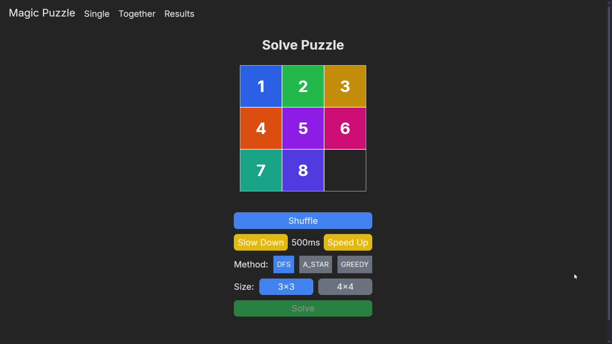
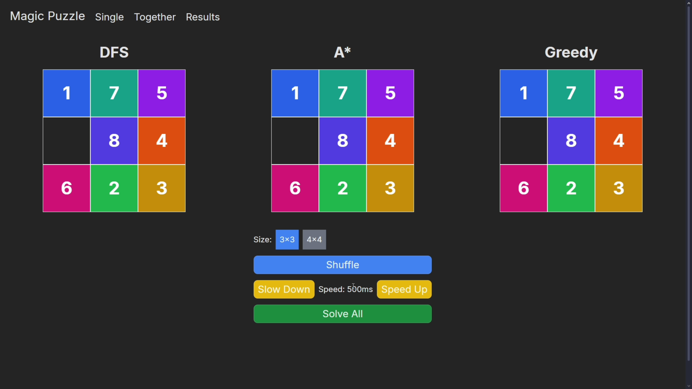
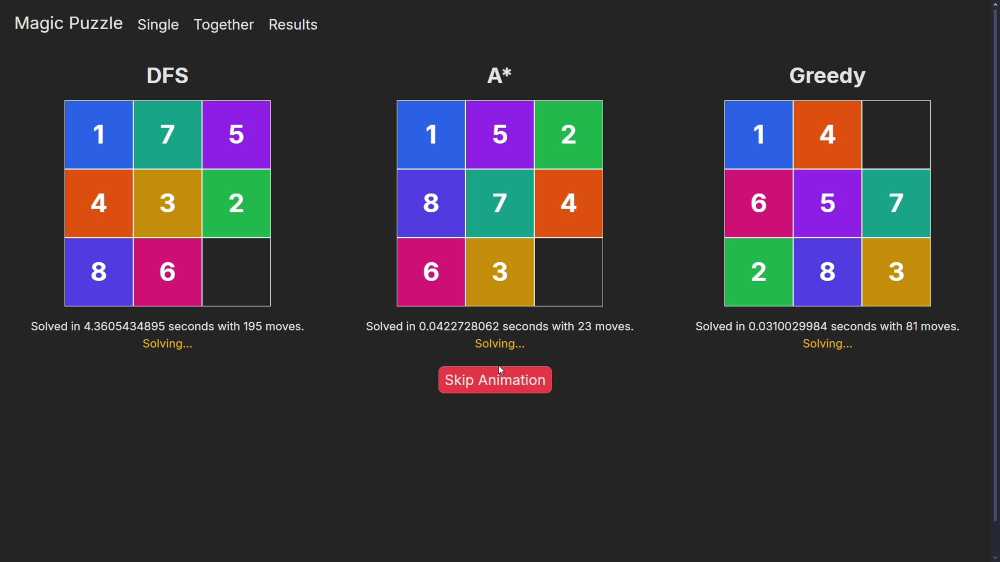
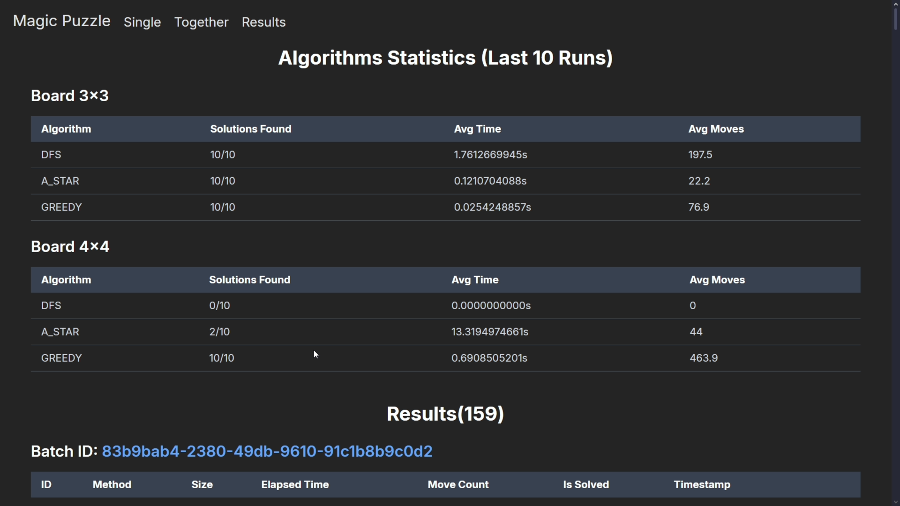

# 🧩 Magic Puzzle Solver with Visualized Algorithms

**Magic Puzzle** is a full-stack application that visually demonstrates solving the classic sliding puzzle (3x3 / 4x4) using advanced search algorithms like **A\***, **Greedy** and **DFS**.
Built with **React + TypeScript + Tailwind CSS** on the frontend and **FastAPI** on the backend, it allows both manual and batch testing with real-time animations and performance insights.

---

## 🎯 Project Goals
- Visually demonstrate and compare search algorithms for solving 8/15 puzzle.
- Allow single and batch solving.
- Record, analyze, and visualize performance statistics.

---

## ✨ Features

- 🎮 **Interactive Puzzle Solver** (3x3 and 4x4)
- 🔁 **Shuffle & Solve**: Watch your puzzle get solved visually
- 🧠 **Algorithms Supported**:
  - **DFS (Depth-First Search)**
  - **A\*** with Manhattan heuristic
  - **Greedy** Best-First with Manhattan heuristic
- 📊 **Compare All**: Solve the same puzzle in all 3 algorithms side by side
- ⚙️ **Speed Controls**: Speed up or slow down solving animation
- 📈 **Result Dashboard**: Shows average solving time, moves, and success rate
- 🧪 **Batch Execution**: Test 10 random puzzles per algorithm and size

---

## 🎥 Demo Video

▶️ **[Click here to watch the demo on YouTube](https://www.youtube.com/watch?v=Y9T3hE1a6ls)**

> The video shows puzzle setup, solving with each algorithm, parallel solving in Together mode, and the results dashboard.

---

## 🖼️ UI Previews

| Single Mode (Solver UI) | Algorithm Compare (Together) |
|-------------------------|------------------------------|
|   |      |

| Solving Process         | Statistics & Results         |
|-------------------------|------------------------------|
|  |       |

---

## 🧰 Tech Stack

| Layer     | Technology                        |
|-----------|------------------------------------|
| Frontend  | React + TypeScript + Tailwind CSS |
| Backend   | Python FastAPI + SQLAlchemy       |
| Database  | SQLite                            |
| Tooling   | Vite (frontend), Uvicorn (backend) |

---

## 🚀 Getting Started

### 🔧 Backend (FastAPI)
Make sure you have Python 3.10+
```bash
cd backend
pip install -r requirements.txt
uvicorn app:app --reload
```
Runs on: `http://localhost:8000`

### 💻 Frontend (React + Vite)
```bash
cd frontend
npm install
npm run dev
```
Runs on: `http://localhost:5173`

---

## 📊 Algorithm Overview

This project showcases and compares three classical search algorithms in the context of solving the **8-puzzle (3×3)** and **15-puzzle (4×4)** problems. Here's a breakdown:

| Algorithm | Heuristic       | Complete | Optimal | Time Complexity         | Description |
|-----------|------------------|----------|---------|--------------------------|-------------|
| DFS       | None             | ❌       | ❌      | O(b^d)                   | Explores as deep as possible before backtracking. Fast on lucky branches, but often misses solution or hits memory limits on large boards. |
| Greedy    | Manhattan        | ❌       | ❌      | O(b^m)                   | Prioritizes nodes that seem closest to goal, using Manhattan distance. Fast but non-optimal, may take wrong paths. |
| A\*       | Manhattan        | ✅       | ✅      | O(b^m) with pruning      | Combines actual cost with heuristic; guarantees optimal path (if heuristic is admissible). Slower but safest. |

- `b` = branching factor (typically ~2.13 for 8-puzzle)
- `d` = actual depth of solution
- `m` = estimated cost to goal (via heuristic)

### 🔍 Heuristic Used
All informed algorithms use the **Manhattan Distance**, calculated as the sum of distances each tile is from its goal position (row + column moves).

### 📌 Practical Observations
- **DFS** works well on small boards (3×3) but fails to find solutions in deeper puzzles (4×4) due to lack of guidance.
- **Greedy** is very fast but may return suboptimal solutions (longer paths).
- **A\*** is the most reliable and accurate but takes longer to compute, especially on 4×4.

Use **Together mode** to watch them side-by-side and compare solving speed, steps, and result quality.

---

## 📝 Notes

- In **Together** mode, all three algorithms solve the same board simultaneously.
- All solving runs (last 10 per algorithm/size) are stored in local DB and visible in `Results` tab.
- DFS often fails on 4x4 due to depth/complexity.

---

## 📜 License

This project is open-source under the **MIT License**.

---

## 👤 Author

Developed by [Vadym Brovych](mailto:vadmabos.programming@gmail.com)  
🗓️ Original development: Dec 2024
